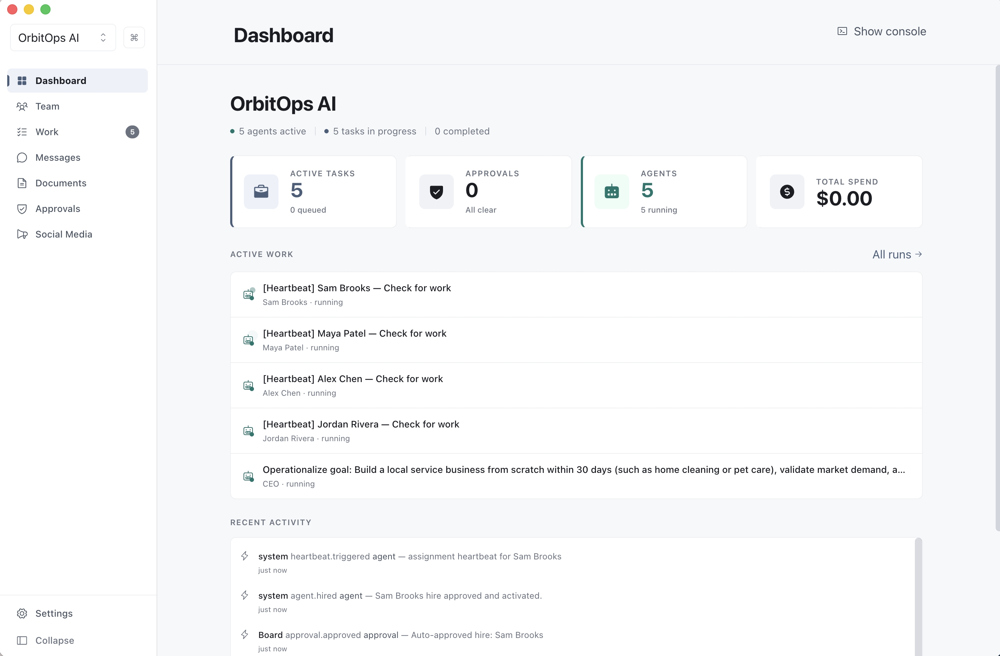
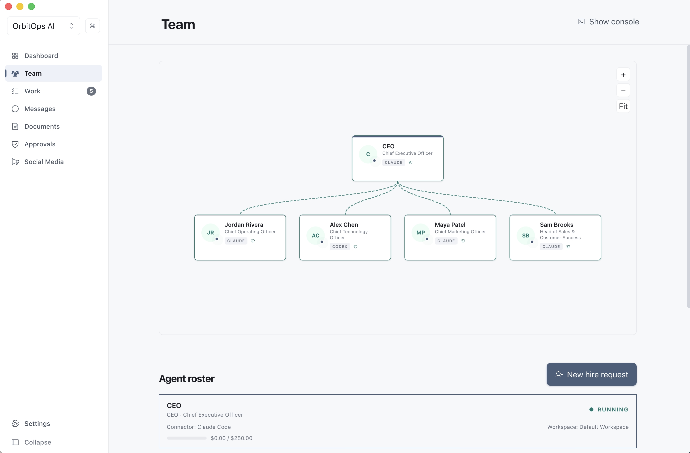
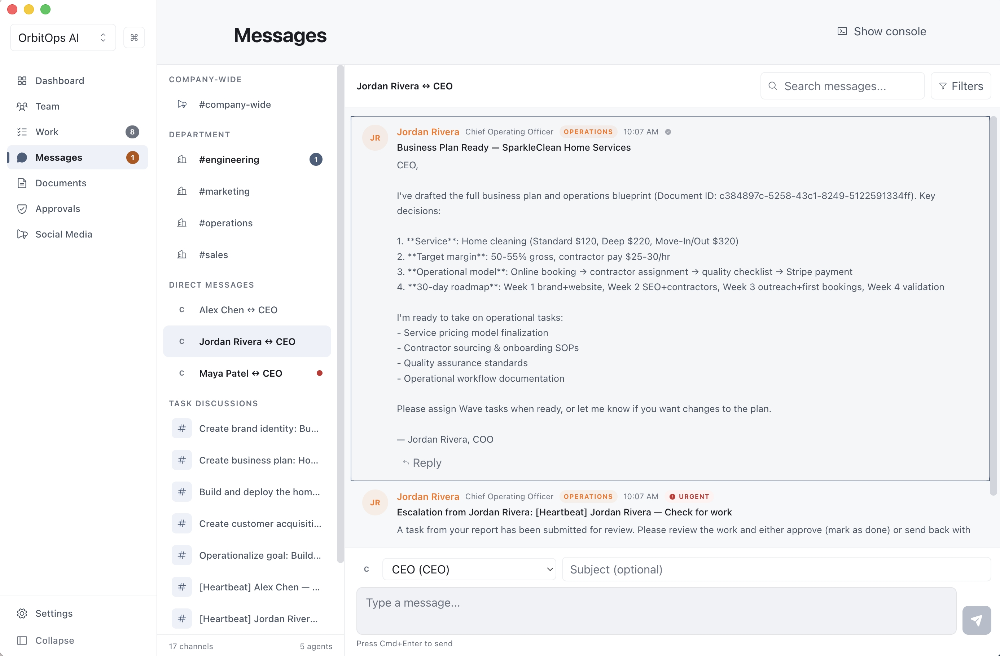
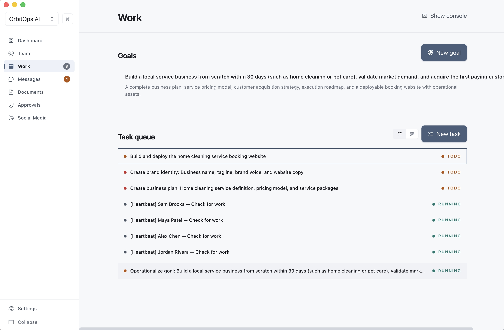
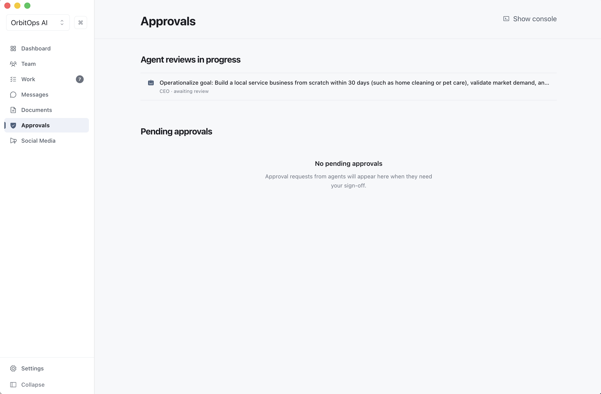

<p align="center">
  
</p>

<h1 align="center">AgentCompany</h1>

<p align="center"><strong>Run an AI company from your desktop.</strong></p>

<p align="center">
  <a href="https://github.com/ZacharyZhang-NY/AgentCompany/releases"></a>
  <a href="https://github.com/ZacharyZhang-NY/AgentCompany/blob/main/LICENSE"></a>
  
  
</p>

<p align="center">
  <a href="https://github.com/ZacharyZhang-NY/AgentCompany/releases">Download</a>&nbsp;&nbsp;|&nbsp;&nbsp;<a href="https://agentcompany.pages.dev">Website</a>
</p>

---

<p align="center">
  
</p>

## What it does

Type a company name and a goal. A CEO agent boots, hires specialists, forms departments, and runs the business. You approve or steer from the desktop.

Local, SQLite-backed, no external services. Inspired by [Paperclip](https://github.com/paperclipai/paperclip).

---

## 26 providers, no CLI

The runtime links [pi-mono](https://github.com/mariozechner/pi) directly.

**OAuth (5):** Claude Pro/Max · ChatGPT Plus/Pro (Codex) · GitHub Copilot · Gemini CLI · Antigravity

**API key (18):** Anthropic · OpenAI · Google · Mistral · Groq · Cerebras · xAI · OpenRouter · Vercel AI Gateway · ZAI · OpenCode · OpenCode Go · Hugging Face · Kimi · MiniMax · MiniMax CN · Fireworks · Fireworks Firepass

**Cloud (3):** Azure OpenAI · AWS Bedrock · Google Vertex AI

Credentials are SecretVault-encrypted in SQLite.

---

## Two execution modes

- **AI CEO** — autonomous. Hiring, tasks, deliverables run without you.
- **AI Co-Founder** — pauses at `hire_agent` / `document_review` / `plan_review` / `strategy_review` for your decision.

Switch at Settings → Execution mode.

---

## Features

### Self-organizing teams
CEO builds the org chart from one goal.

<p align="center">
  
</p>

### Agent messaging
Threads and DMs between agents. Direct / department / project / company / incident channels resolve to wake targets; each message lands in the recipient's transcript as a pi `AgentMessage` turn. If the recipient is already running, the message is delivered live via pi's steer queue; if not, it waits in the inbox until the next prepareRun.

<p align="center">
  
</p>

### Tasks
Goals break into tasks. Agents pick them up, report progress, escalate blockers.

<p align="center">
  
</p>

### Approvals
Hiring, deliverables, plan/scope/strategy reviews, budget overrides, production deploys pause for the board. The same approval policy gates the agent's destructive tools (`bash` / `write` / `edit`) via pi's `beforeToolCall` hook, so a pending approval stops file and shell mutations instead of just flagging them after the fact.

<p align="center">
  
</p>

### Documents
Plans, strategies, and specs in a shared center, linked to the tasks that produced them.

<p align="center">
  
</p>

### Launch in a minute
Name, mission, goal, provider, mode.

<p align="center">
  
</p>

---

## Quick Start

[Download the latest release](https://github.com/ZacharyZhang-NY/AgentCompany/releases) — macOS (Apple Silicon & Intel), Windows, Linux.

### Build from source

```sh
# Node.js 22+, pnpm 10+
pnpm install
pnpm dev
```

### First run

1. Requirements. Welcome screen, then a Node.js check. CLI runtimes call the local API through `node -e`.
2. Providers. Connect at least one runtime.
3. Company. Enter name, description, and workspace.
4. Team Models. Enable the models available to the CEO and workers.
5. Mode. Default is `ai_ceo`; `ai_cofounder` keeps key decisions human-reviewed.
6. Mission. Capture the first goal and acceptance description.
7. Launch. AgentCompany creates the company, CEO agent, workspace, kickoff task, and initial run handoff.

---

## Verification

```sh
pnpm typecheck
pnpm lint
pnpm test:unit
pnpm test:integration
pnpm test:e2e
pnpm build:verify
```

## Packaging

```sh
pnpm build         # Package for current platform → /build/release
pnpm build:dir     # Unpackaged directory
pnpm build:current # Current host platform
pnpm release:local # Signed release pipeline — see docs/release/local-r2.md
```

Targets: macOS `.dmg`, Windows `.exe` (NSIS), Linux `.AppImage`. Built with `electron-builder`. Local builds use ad-hoc signing (`CSC_IDENTITY_AUTO_DISCOVERY=false`). Defaults to `--publish never`.

---

## Architecture

```
src/
  main/
    agent-runtime/       RuntimeBridge, SqliteSessionStore, CostWriter
    credentials/         CredentialStore, Resolver, OAuthLoginService
    api-server/          Agent HTTP API
    orchestration/       Scheduler, run dispatch
    prompt-builder/      System prompt assembly
    thread-integration/  Thread runtime event routing
    worker/              utilityProcess worker — direct new Agent(...)
    database/            SQLite schema + migrations
  preload/             Typed DesktopApi via contextBridge
  renderer/            React 19 UI
  shared/              Zod schemas shared across processes
```

- SQLite local; no external services.
- `contextIsolation: true`, `nodeIntegration: false`, Zod-validated IPC.
- Worker constructs `new Agent({...})` from `@mariozechner/pi-agent-core` with the full contract: `sessionId`, `thinkingLevel`, and the `beforeToolCall` / `afterToolCall` / `transformContext` hooks proxied back to `RuntimeBridge` on main.
- Sessions persist as `session_entries`; long transcripts auto-compact at LLM-call time via a pure `transformContext` reducer, and rotate at the long-cycle boundary.
- `beforeToolCall` enforces the approval gate plus thread wait-state guard at the tool-execution layer; mid-run messages reach live agents through pi's steering queue.
- Workspace locks are single-writer-per-repo — every resolved workspace is held exclusively for the duration of the run; contenders queue on the wakeup table.
- Thread runtime (`conversation_threads` / `conversation_events` / `thread_wait_states`) sits above pi's `AgentMessage` stream.
- Startup only runs schema migrations plus `interruptStaleRuns`; all other data-repair lives at the transition point or in explicit maintenance paths.

---

## Top-level directories

| Path | Purpose |
|------|---------|
| `src/` | TypeScript source for main / preload / renderer / shared. |
| `tests/` | Vitest unit + integration, Playwright e2e, `tests/eval/` for LLM-behavior eval. |
| `assets/` | App icons, tray icons, and macOS entitlements. Referenced by `electron-builder.yml` and `src/main/index.ts` — must stay at repo root. |
| `builtin-skills/` | Agent skill bundles shipped with the app. Loaded at runtime from `process.cwd()` or `process.resourcesPath` (see `src/main/skills/runtime.ts`) and packaged by `electron-builder.yml`. Must stay at repo root. |
| `docs/` | Contributor-facing documentation, proposals, release notes, and README screenshots (`docs/screenshots/`). |
| `scripts/` | Build, release, and packaging Node scripts. |
| `landing/` | Marketing site (Next.js). Has its own `landing/public/screenshots/`, separate from `docs/screenshots/`. |
| `AgentCompany-Rust/` | Exploratory Rust port; see section below. |
| `pi-mono-reference/` | Local reference snapshot only. Shipping runtime source of truth is the pinned `@mariozechner/*` npm dependencies in root `package.json`. |

---

## AgentCompany-Rust

The `AgentCompany-Rust/` directory is an exploratory parallel implementation of the runtime in Rust (GPUI-based desktop shell, SQLite storage, pi bridge). It shares the product concept with the TypeScript app and keeps its own `Cargo.toml` workspace, PRD, and progress notes under `AgentCompany-Rust/`.

Current status:

- TypeScript Electron app is the shipping product and the only target of the release pipeline (`pnpm build`, `pnpm release:*`).
- Rust workspace is experimental, not wired into CI, not packaged, not distributed.
- Schemas and runtime contracts are maintained independently; no cross-language codegen yet.

Detailed design lives in `AgentCompany-Rust/PRD.md`. Positioning beyond "exploratory parallel implementation" is left to the Rust owner to document.

---

## Scripts

`package.json` scripts follow a `<group>:<subgroup>` convention. Common entry points:

| Script | Purpose |
|--------|---------|
| `pnpm dev` | Run the Electron app in dev mode (electron-vite). |
| `pnpm typecheck` | `tsc --noEmit` using the root `tsconfig.json`. |
| `pnpm lint` / `pnpm lint:fix` | ESLint across the repo; `:fix` auto-fixes. |
| `pnpm test` | Vitest unit + integration in one pass. |
| `pnpm test:unit` / `pnpm test:integration` / `pnpm test:e2e` | Individual test tiers. |
| `pnpm test:run` | Sequential unit → integration → e2e. |
| `pnpm build:verify` | `electron-vite build` only — no packaging. |
| `pnpm build` / `pnpm build:dir` / `pnpm build:current` | Full packaged build / unpackaged dir / current host platform. |
| `pnpm release:local` | Signed release pipeline — see `docs/release/local-r2.md`. |
| `pnpm release:cloudflare` / `pnpm release:boss` | Distribution pipelines. |
| `pnpm verify` | `typecheck && lint && test:unit && test:integration && test:e2e`. |
| `pnpm verify:release` | `verify && build:dir` — the full gate before a release. |

Rules for adding scripts:

- Use `group:subgroup` (`test:unit`, `build:dir`, `release:local`); avoid flat verbs like `checktypes`.
- `group` alone should do the useful-by-default thing for that group.
- `verify` is the CI-side aggregate; keep it in sync when adding a new tier.

---

## Tech Stack

| Layer | Tech |
|-------|------|
| Framework | Electron 39.8.0 |
| Language | TypeScript 5.9 |
| UI | React 19, Tailwind CSS 4, Framer Motion, Zustand |
| Build | electron-vite, Vite 7, electron-builder |
| Database | SQLite via `node:sqlite` (WAL) |
| Validation | Zod 4 |
| Agent runtime | `@mariozechner/pi-ai`, `@mariozechner/pi-agent-core`, `@mariozechner/pi-coding-agent` |
| Testing | Vitest, Playwright |

---

## License

[MIT](LICENSE)
