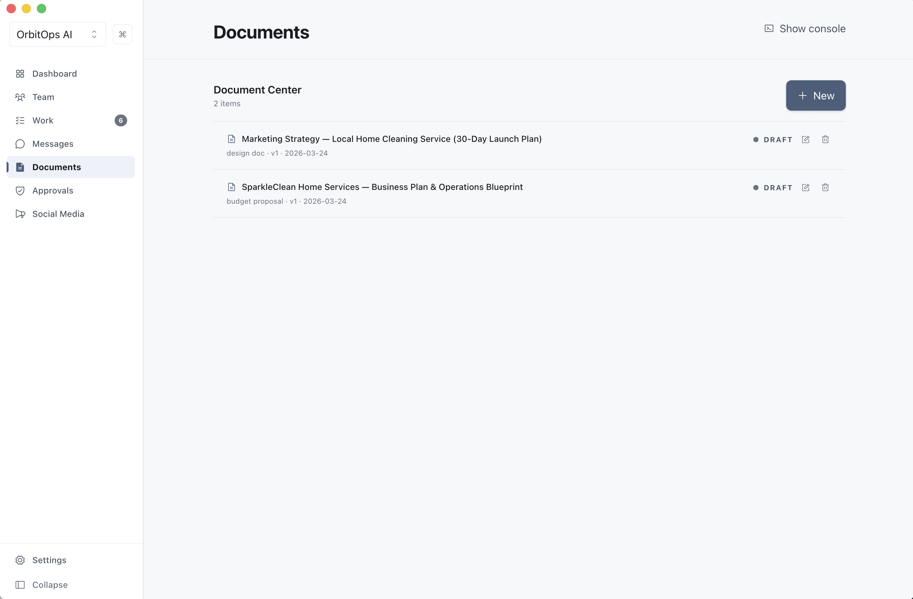
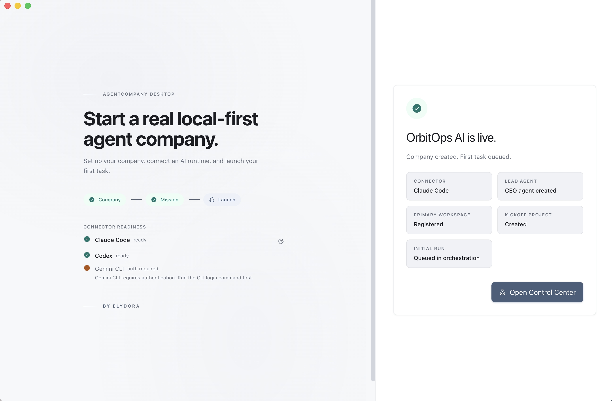

<p align="center">
  
</p>

<h1 align="center">AgentCompany</h1>

<p align="center"><strong>Run an AI company from your desktop.</strong></p>

<p align="center">
  <a href="https://github.com/ZacharyZhang-NY/AgentCompany/releases"></a>
  <a href="https://github.com/ZacharyZhang-NY/AgentCompany/blob/main/LICENSE"></a>
  
  
</p>

<p align="center">
  <a href="https://github.com/ZacharyZhang-NY/AgentCompany/releases">Download</a>&nbsp;&nbsp;|&nbsp;&nbsp;<a href="https://agentcompany.pages.dev">Website</a>
</p>

---

<p align="center">
  
</p>

## What it does

Type a company name and a goal. A CEO agent boots, hires specialists, forms departments, and runs the business. You approve or steer from the desktop.

Local, SQLite-backed, no external services. Inspired by [Paperclip](https://github.com/paperclipai/paperclip).

---

## 26 providers, no CLI

The runtime links [pi-mono](https://github.com/mariozechner/pi) directly. No `claude` / `codex` / `gemini` binaries on your PATH.

**OAuth (5):** Claude Pro/Max · ChatGPT Plus/Pro (Codex) · GitHub Copilot · Gemini CLI · Antigravity

**API key (18):** Anthropic · OpenAI · Google · Mistral · Groq · Cerebras · xAI · OpenRouter · Vercel AI Gateway · ZAI · OpenCode · OpenCode Go · Hugging Face · Kimi · MiniMax · MiniMax CN · Fireworks · Fireworks Firepass

**Cloud (3):** Azure OpenAI · AWS Bedrock · Google Vertex AI

Credentials are SecretVault-encrypted in SQLite.

---

## Two execution modes

- **AI CEO** — autonomous. Hiring, tasks, deliverables run without you.
- **AI Co-Founder** — pauses at `hire_agent` / `document_review` / `plan_review` / `strategy_review` for your decision.

Switch at Settings → Execution mode.

---

## Features

### Self-organizing teams
CEO builds the org chart from one goal.

<p align="center">
  
</p>

### Agent messaging
Threads and DMs between agents. Messages land in each recipient's transcript as pi `AgentMessage` turns.

<p align="center">
  
</p>

### Tasks
Goals break into tasks. Agents pick them up, report progress, escalate blockers.

<p align="center">
  
</p>

### Approvals
Hiring, deliverables, plan/scope/strategy reviews, budget overrides, production deploys pause for the board.

<p align="center">
  
</p>

### Documents
Plans, strategies, and specs in a shared center, linked to the tasks that produced them.

<p align="center">
  
</p>

### Launch in a minute
Name, mission, goal, provider, mode.

<p align="center">
  
</p>

---

## Quick Start

[Download the latest release](https://github.com/ZacharyZhang-NY/AgentCompany/releases) — macOS (Apple Silicon & Intel), Windows, Linux.

### Build from source

```sh
# Node.js 22+, pnpm 10+
pnpm install
pnpm dev
```

### First run

1. Onboarding probes your shell PATH for `node` (agents call the local HTTP API via `node -e`).
2. Settings → Providers. Sign in or drop a key.
3. Create a company: name, mission, goal, mode, workspace.

---

## Verification

```sh
pnpm typecheck
pnpm lint
pnpm test:unit
pnpm test:integration
pnpm test:e2e
pnpm build:verify
```

## Packaging

```sh
pnpm build         # Package for current platform → /build/release
pnpm build:dir     # Unpackaged directory
pnpm build:current # Current host platform
pnpm release:local # Signed release pipeline — see docs/release/local-r2.md
```

Targets: macOS `.dmg`, Windows `.exe` (NSIS), Linux `.AppImage`. Built with `electron-builder`. Local builds use ad-hoc signing (`CSC_IDENTITY_AUTO_DISCOVERY=false`). Defaults to `--publish never`.

---

## Architecture

```
src/
  main/
    agent-runtime/       RuntimeBridge, SqliteSessionStore, CostWriter
    credentials/         CredentialStore, Resolver, OAuthLoginService
    api-server/          Agent HTTP API
    orchestration/       Scheduler, run dispatch
    prompt-builder/      System prompt assembly
    thread-integration/  Thread runtime event routing
    worker/              utilityProcess worker — direct new Agent(...)
    database/            SQLite schema + migrations
  preload/             Typed DesktopApi via contextBridge
  renderer/            React 19 UI
  shared/              Zod schemas shared across processes
```

- SQLite local; no external services.
- `contextIsolation: true`, `nodeIntegration: false`, Zod-validated IPC.
- Worker constructs `new Agent({...})` from `@mariozechner/pi-agent-core` directly.
- Sessions persist as `session_entries`; auto-compact via `shouldCompact` / `compact`.
- Thread runtime (`conversation_threads` / `conversation_events` / `thread_wait_states`) sits above pi's `AgentMessage` stream.

---

## Tech Stack

| Layer | Tech |
|-------|------|
| Framework | Electron 39.8.0 |
| Language | TypeScript 5.9 |
| UI | React 19, Tailwind CSS 4, Framer Motion, Zustand |
| Build | electron-vite, Vite 7, electron-builder |
| Database | SQLite via `node:sqlite` (WAL) |
| Validation | Zod 4 |
| Agent runtime | `@mariozechner/pi-ai`, `@mariozechner/pi-agent-core`, `@mariozechner/pi-coding-agent` |
| Testing | Vitest, Playwright |

---

## License

[MIT](LICENSE)
